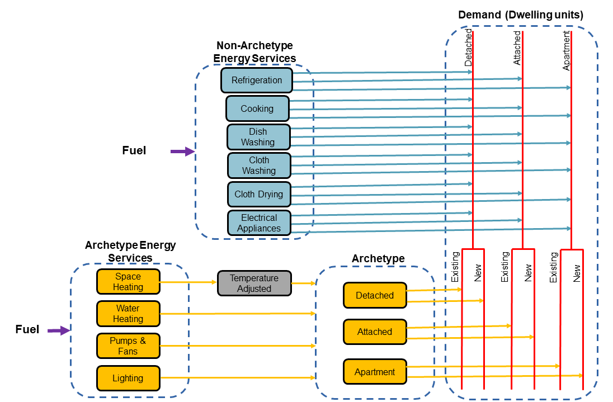

Residential sector
=======================

Overview
--------

The residential sector in the TIMES Ireland Model (TIM) represents the energy consumption and associated emissions of Irish households. The housing stock is described through dwelling archetypes, which are built from the SEAI Building Energy Rating (BER) database and adjusted to the housing stock reported in the CSO Census.

This page describes the structure of the sector and the changes introduced in the updated version of TIM. The two main changes are:

- **Simplified BER split**: dwellings are now grouped into four BER bands (A, B, C-D and E-F) instead of the more detailed split used in the previous version.
- **Private battery electric vehicles (BEVs) with a separate battery**: the battery of a private BEV is now modelled as a separate technology that has to be charged before the vehicle can use the energy.

Together, these updates make the model smaller and allow faster model runs, or allow the saved computational effort to be spent on a more detailed temporal resolution.

Sector structure
----------------

    Reference energy system of the residential sector

Energy service demands in the residential sector are expressed per dwelling unit and are split into two groups:

- **Archetype energy services**: space heating, water heating, pumps and fans, and lighting. These demands depend on the dwelling type and its energy performance, so they are linked to the dwelling archetypes. Space heating demand is adjusted for temperature.
- **Non-archetype energy services**: refrigeration, cooking, dish washing, clothes washing, clothes drying and electrical appliances. These demands are linked to the number of dwellings but not to their energy rating.

The housing stock is divided into three dwelling types:

- **Detached** houses
- **Attached** houses (semi-detached and terraced)
- **Apartments**

Each dwelling type is further split into existing and new dwellings, and each dwelling archetype is assigned a BER band that sets its energy service demand.

Changes in the updated version
------------------------------

The table below summarises the differences between the previous and the updated version of the residential sector.

.. list-table::
   :widths: 25, 37, 38
   :header-rows: 1

   * - Feature
     - Previous version
     - Updated version
   * - BER classes
     - A, B1, B2, B3, C, D, E, F, G
     - A, B, C-D, E-F
   * - Building archetypes
     - 27 (3 dwelling types x 9 BER classes)
     - 12 (3 dwelling types x 4 BER bands)
   * - Space heating demands
     - 18 (3 dwelling types x 6 BER groups: AB, C, D, E, F, G)
     - 12 (3 dwelling types x 4 BER bands)
   * - Private BEVs
     - Vehicles draw electricity directly at the time of driving
     - Vehicles draw energy from a separate battery technology that is charged from the grid

Simplified BER split
--------------------

**Previous version**

In the previous version, each dwelling type was split into nine BER classes (A, B1, B2, B3, C, D, E, F and G), giving 27 building archetypes. Space heating demands were defined for six BER groups per dwelling type (AB, C, D, E, F and G), giving 18 space heating demand commodities. Retrofit options were defined for most of these classes, with shallow retrofits for B3, C and D dwellings and deep retrofits for E, F and G dwellings.

**Updated version**

In the updated version, the BER classes are aggregated into four bands:

.. list-table::
   :widths: 30, 70
   :header-rows: 1

   * - BER band
     - Previous BER classes included
   * - A
     - A
   * - B
     - B1, B2, B3
   * - C-D
     - C, D
   * - E-F
     - E, F, G

The four bands keep the distinction that matters most for the sector's decarbonisation pathways: highly efficient dwellings (A), dwellings at or near the B2 retrofit target (B), dwellings that need a moderate upgrade (C-D) and poorly performing dwellings that need a deep retrofit (E-F). Building archetypes and space heating demands are now defined for each combination of dwelling type and BER band, which reduces the number of archetypes from 27 to 12.

**Benefits**

- Fewer building archetypes, demand commodities and retrofit options mean fewer variables and constraints in the optimisation problem.
- Shorter solve times, which make it easier to run large scenario sets and sensitivity analyses.
- The saved computational effort can be used to increase the number of time slices, which is important for the representation of heat pumps, electric vehicles and variable renewable electricity.

Private battery electric vehicles
---------------------------------

Charging of private cars is described in this chapter because it mostly takes place at home and adds to the household electricity demand profile.

**Previous version**

In the previous version, a private BEV consumed electricity directly. The electricity used by the car in each time slice was the electricity needed to cover the distance driven in that time slice, so charging was always assumed to happen at the same time as driving.

**Updated version**

In the updated version, the battery of a private BEV is modelled as a separate technology. Electricity is first used to charge the battery, and the vehicle then draws the energy it needs for driving from the battery:

.. code-block:: text

   Electricity  -->  BEV battery (charging)  -->  Private BEV  -->  Passenger transport demand

**Benefits**

- Charging is decoupled from driving, so the model can choose when vehicles are charged, for example overnight or at times of high renewable output.
- The effect of EV charging on peak electricity demand and on the need for generation, storage and network capacity is captured more realistically.
- The approach becomes more valuable as the temporal resolution of the model increases, since the timing of charging can then be represented in more detail.

Results
-------

.. note::

   This section will be updated soon with results from the updated version of the residential sector, including a comparison with the previous version.

Data Sources
------------

The primary data sources for the residential sector include:

- SEAI BER Public Database
- CSO Census of Population (housing stock by dwelling type and year of construction)
- CSO Energy Balance statistics
- SEAI National Heat Study
